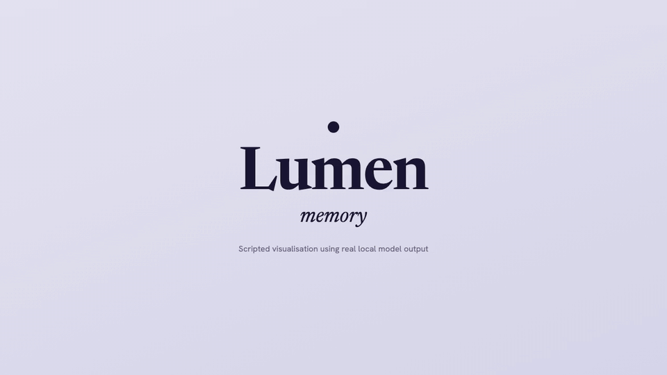

# Lumen

Hold a hotkey, ask a question out loud, and a voice assistant that can see your screen answers by voice and points at the button it's talking about. It runs on your Mac, defaults to fully local models, and remembers you between sessions.



*Scripted visualisation of the memory feature using real local model output. [Narrated video](docs/media/lumen-memory-demo.mp4).*

Lumen started as a fork of [farzaa/clicky](https://github.com/farzaa/clicky), the MIT-licensed April 2026 prototype of what became [HeyClicky](https://www.heyclicky.com/), and has since been renamed and redesigned. The original copyright notice stays in `LICENSE`.

## What's different from upstream

Upstream routed every API call through a Cloudflare Worker that held the keys. Lumen:

- **Calls providers directly.** No Worker, no Cloudflare account. API keys go in the in-app **AI Settings** panel and are stored in the macOS Keychain.
- **Is provider-agnostic.** The chat model can be any OpenAI-compatible endpoint (OpenRouter, Ollama, LM Studio, vLLM…) or Anthropic directly. One OpenRouter key reaches Haiku 5.5, DeepSeek, GLM, Qwen-VL, Gemini, etc.
- **Runs fully offline by default.** Fresh install = Apple Speech (STT) → Ollama on localhost (vision LLM) → Kokoro (local neural TTS, one-time ~380 MB model download). Zero accounts needed. AssemblyAI and ElevenLabs are opt-in toggles.
- **Phones home to nobody.** Upstream's PostHog telemetry, FormSpark email capture and Sparkle update feed are removed.
- **Remembers you.** A plain-Markdown profile (`PROFILE.md`) plus a daily note per day live in `~/Library/Application Support/Lumen/Memory/` and are fed to the model with every question (past days by embedding search). Say "remember that …" or let the model save facts itself; "forget …" removes them. Two small Ollama models (`embeddinggemma`, `gemma4:e2b`, ~5 GB) download once at launch. Everything you say after "remember that" is stored verbatim, and each question and answer is summarised into the day's note, so don't dictate secrets. Toggle it off in AI Settings → Memory.

The overlay mechanics, screen capture and push-to-talk pipeline are still based on Farza's code.

## Setup

### Prerequisites

- macOS 14.2+ (ScreenCaptureKit). Developed on macOS 26 / Xcode 26.
- For the offline default: [Ollama](https://ollama.com) with a vision-capable model, e.g. `ollama pull gemma4:26b` (18 GB, needs ~24 GB RAM) or a smaller `qwen3-vl` tag.
- Optional: an [OpenRouter](https://openrouter.ai/keys) key for cloud models.

### Build

```bash
open leanring-buddy.xcodeproj
```

In Xcode: select the `leanring-buddy` scheme (the typo is intentional, long story), set your signing team under Signing & Capabilities, **Cmd + R**.

Do not build with `xcodebuild` from the terminal — it invalidates the TCC permission grants and you'll have to re-grant everything.

### First run

1. The app appears in the menu bar (no dock icon). Click it and grant the four permissions: Microphone, Accessibility, Screen Recording, Screen Content.
2. Expand **AI Settings** in the panel:
   - **Provider** — `Ollama (local)` with model `gemma4:26b` is the default. Switch to `OpenRouter`, paste a key, click Save; the model defaults to `anthropic/claude-haiku-5.5`.
   - **Speech to text** — Apple (local) by default. AssemblyAI / OpenAI need a key.
   - **Text to speech** — Kokoro (local) by default: a British male voice out of the box, 28 voices in the menu, models download once from Hugging Face on first use (the status line under the Voice menu shows progress). Apple voices need no download (pick an *Enhanced*/*Premium* voice in System Settings → Accessibility → Spoken Content for best results). ElevenLabs needs a key.
3. Hold **Control + Option**, ask something about your screen, release.

Keys are read from the Keychain (service `com.willhammond.lumen`). `.env.example` documents them but is never read by the app.

## Architecture

Menu bar app (`LSUIElement`) with two `NSPanel`s — the control panel and a full-screen transparent cursor overlay. Push-to-talk streams mic audio to the configured transcription provider; the transcript plus a JPEG of every screen goes to the configured chat client; the reply is parsed for a trailing `[POINT:x,y:label:screenN]` tag, spoken via the configured TTS client, and the cursor flies to the coordinate.

```
leanring-buddy/
  CompanionManager.swift            # state machine: push-to-talk → screenshot → chat → TTS → pointing
  AppSettings.swift                 # provider / model / voice choices (UserDefaults)
  SecretsStore.swift                # API keys (Keychain)
  ChatClient.swift                  # protocol + factory
  OpenAICompatibleChatClient.swift  # OpenRouter / Ollama / any /chat/completions server
  ClaudeAPI.swift                   # Anthropic Messages API (direct)
  TTSClient.swift                   # protocol + factory
  KokoroTTSClient.swift             # Kokoro on-device (default): sentence queue + Apple fallback
  KokoroVoiceEngine.swift           # owns the FluidAudio Kokoro model; load state
  SentenceAudioQueuePlayer.swift    # gapless AVAudioEngine playback of sentence buffers
  SentenceSplitter.swift            # sentence chunking for TTS (unit-tested)
  KokoroVoiceCatalog.swift          # voice codes + labels (unit-tested)
  AppleSpeechTTSClient.swift        # AVSpeechSynthesizer (zero-download fallback)
  MemoryManager.swift               # profile + daily notes → system prompt; [REMEMBER]/[FORGET] tags
  MemoryStore.swift                 # file I/O under Application Support/Lumen/Memory
  MemoryIndex.swift                 # embedding index + cosine search (unit-tested)
  ElevenLabsTTSClient.swift         # ElevenLabs (direct)
  BuddyTranscriptionProvider.swift  # STT protocol + factory (Apple / AssemblyAI / OpenAI)
  CompanionPanelView.swift          # menu bar panel incl. AI Settings
  OverlayWindow.swift               # cursor overlay + pointing animation
```

See `AGENTS.md` for the full file map and conventions.

## License

MIT — see `LICENSE`. Original work © 2026 Farza.
